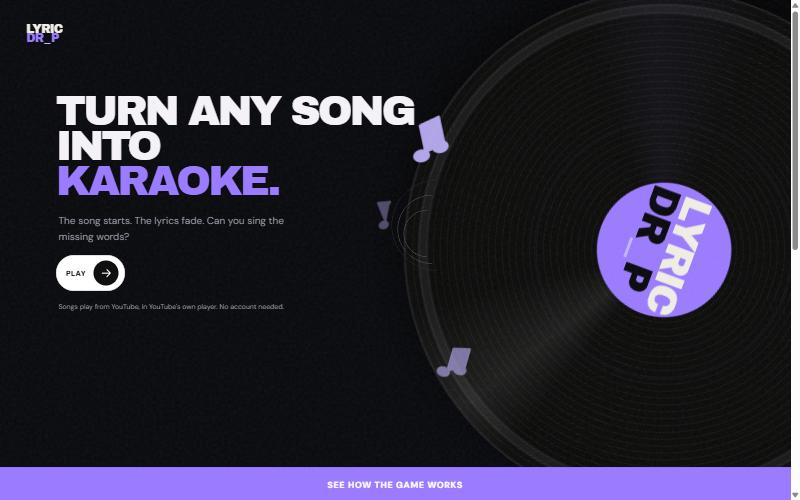
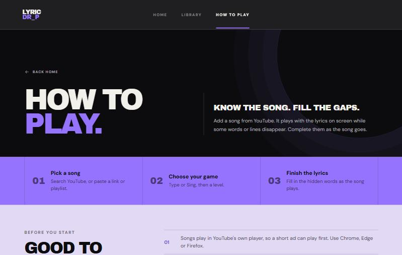

# Lyric Drop

A lyrics-training game. Pick a song from YouTube, listen to it in the browser, and fill in the words that drop out of the lyrics as they're sung.



- **Type mode**: type the hidden words before the line moves on.
- **Sing mode**: sing the hidden lines out loud; the game listens through your microphone.
- Three levels (Easy, Medium, Hard), a score at the end of each song, and a list of the words you keep missing.
- Your own library: add songs by name or by link, keep them in lists you name, and mark favorites.

Lyrics come from [LRCLIB](https://lrclib.net), a free lyrics service. Songs without timed lyrics show up in your library but can't be played.



## Three ways to use it

1. **Open the web version.** A copy for friends runs at [lyrics-game-two.vercel.app](https://lyrics-game-two.vercel.app). It asks for a shared word: ask whoever sent you the link. It plays YouTube songs only.
2. **Run it on your computer.** Free, about 20 minutes to set up. YouTube songs need a free YouTube key; Spotify is optional. See [Setup](#setup-once).
3. **Put your own web version online** for your own friends, free. See [A web version for friends](#a-web-version-for-friends-optional).

> **Personal project.** The web version is meant for friends, not for the public: the lyrics aren't licensed for public use, and YouTube's free allowance is small. Please keep your copy small too.

## Where the music comes from

- **YouTube** (free): songs and playlists you add by pasting a link or searching a name. They play in YouTube's official embedded player, shown small in the corner of the game. A short ad can play first, and the game waits for it. This is the main source, and the only one in the web version.
- **Spotify** (optional, needs Premium, only on your own computer): your Liked Songs and playlists, played through Spotify's own player. Spotify's rules don't allow publishing a game built on it, so the web version has no Spotify at all.

The app never downloads audio from YouTube, never hides its player and never blocks its ads: that's against YouTube's terms, and it isn't needed.

## What you need

- **Node.js 24** ([nodejs.org](https://nodejs.org)) and **Git** ([git-scm.com](https://git-scm.com)).
- **A free YouTube key** (step 2 below).
- **A desktop browser**: Chrome, Edge or Firefox. Sing mode needs Chrome or Edge, because it uses the browser's speech recognition.
- **Spotify Premium**, only if you want to play your Spotify library too.

## Setup (once)

### 1. Get the code

```bash
git clone https://github.com/amayouriol/lyrics-game.git
```

This creates a `lyrics-game` folder, and the app lives in another `lyrics-game` folder inside it. Every command below runs from there:

```bash
cd lyrics-game/lyrics-game
```

### 2. Get a free YouTube key (to find and add songs)

1. Go to [console.cloud.google.com](https://console.cloud.google.com) and log in with a Google account. Google asks for 2-step verification on the account first.
2. Create a project (any name).
3. Open **APIs and services**, then **Library**, search for **YouTube Data API v3** and click **Enable**.
4. Open **Credentials**, click **Create credentials**, then **API key**. Under **API restrictions**, limit it to **YouTube Data API v3**. Leave application restrictions on "None".
5. Copy the key.

The key is free. Searching uses part of a small daily allowance (about 100 searches a day), and the app remembers every choice, so only new songs use it. Pasting a link or a playlist costs almost nothing.

### 3. Create your own Spotify app (optional)

Skip this if you only want YouTube. If you want your Spotify library too, each person needs their own Spotify keys. They're free.

1. Go to the [Spotify Developer Dashboard](https://developer.spotify.com/dashboard), log in with your Spotify account and click **Create app**.
2. Give it any name and description.
3. Under **Redirect URIs**, add exactly:
   ```
   http://127.0.0.1:3000/api/auth/callback
   ```
4. Under **Which API/SDKs are you planning to use?**, tick **Web API** and **Web Playback SDK**.
5. Save. In the app's **Settings**, copy the **Client ID** and the **Client secret**.

### 4. Add your keys

In the `lyrics-game` folder, copy `.env.local.example` to a new file named `.env.local`, then fill it in:

```
YOUTUBE_API_KEY=your YouTube key
SESSION_SECRET=a long random text
SPOTIFY_CLIENT_ID=your Client ID
SPOTIFY_CLIENT_SECRET=your Client secret
SPOTIFY_REDIRECT_URI=http://127.0.0.1:3000/api/auth/callback
```

(Using only YouTube? The three Spotify lines can stay empty.)

For `SESSION_SECRET`, this command prints a random one you can paste:

```bash
node -e "console.log(require('crypto').randomBytes(32).toString('hex'))"
```

`.env.local` holds your private keys. Never share it or upload it anywhere (git already ignores it).

### 5. Install

```bash
npm install
```

## Play

```bash
npm run dev
```

Then open **http://127.0.0.1:3000** in your browser. Click **Or use the app without Spotify** to play YouTube songs only, or **Connect with Spotify** if you set it up. Use `127.0.0.1`, not `localhost`, or the Spotify login won't come back to the app.

To add songs, open **Library**. The box at the top is the one place to add: type a song name (and the artist) and pick one of three videos, or paste a YouTube video or a public (or unlisted) playlist link. Below it, **Your lists** holds what you added, in lists you can create, rename and delete, and **Saved** holds your Favorites and Play later. With Spotify connected, a **From Spotify** tab shows your Spotify playlists too.

Leave the terminal open while you play. To stop, press `Ctrl + C` in it. Next time, just run `npm run dev` again.

## Good to know

- **Your data stays on your computer.** Games, saved songs and caches are kept in `lyrics-game/.data/`, which is created on first use and never uploaded. Delete it to start fresh.
- **Lyrics and videos.** Lyrics come from LRCLIB, a community service, and are shown only as the game needs them. On YouTube, the game prefers "Topic" uploads (the cover picture and nothing else), warns about lyrics videos (which would give the words away) and turns YouTube's captions off. Some videos, mostly from big labels, can't be played outside YouTube; the app checks before it saves one and asks you to choose another.
- **Without Spotify** the app only opens from this computer's own address (`127.0.0.1`). Anyone else on your network can't use it that way. For friends, use the web version.

### If you use Spotify

- **Who can log in.** Your Spotify app starts in test mode: only you can log in. To let someone else use *your* copy, add their name and Spotify email in the dashboard under **User Management** (up to 5 people).
- **Spotify limits requests.** If the app asks too often, Spotify blocks it for a few hours. The app keeps a copy of your library for 6 hours and remembers a block, so it won't keep asking. If you see "Spotify is limiting this app until…", wait until that time.
- **If Spotify plays on another device** (your phone, for example), the game pauses. Press play in the app to bring it back.

## A web version for friends (optional)

You can put a copy online that your friends open from a link. It is **YouTube only**, it asks for a **shared word** you give your friends, and each friend's games and songs are kept apart under a random id in their browser. Your own copy on your computer stays as it is.

It runs free on two services. You create the accounts yourself; nothing is paid.

### 1. A free database (Upstash)

1. Sign up at [upstash.com](https://upstash.com) and choose the free plan.
2. Create a **Redis** database and pick the region closest to your friends.
3. Open the database and find the **REST API** section. Keep two values: `UPSTASH_REDIS_REST_URL` and `UPSTASH_REDIS_REST_TOKEN` (the normal read-and-write token).

### 2. A place to run it (Vercel)

1. Sign up at [vercel.com](https://vercel.com) with GitHub and choose the free **Hobby** plan (for personal, non-commercial use).
2. **Add New → Project**, pick this repository, and set **Root Directory** to `lyrics-game`.
3. Before the first deploy, open **Environment Variables** and add these five, ticked for **Production** and **Preview**. Type them yourself; never put them in the code or in git:

| Name | Value |
| --- | --- |
| `APP_MODE` | `web` |
| `WEB_GATE_WORD` | the shared word you choose (case doesn't matter) |
| `YOUTUBE_API_KEY` | your YouTube key (step 2 of the setup above) |
| `UPSTASH_REDIS_REST_URL` | from Upstash |
| `UPSTASH_REDIS_REST_TOKEN` | from Upstash |

4. Click **Deploy**. Vercel gives you an address like `your-project.vercel.app`. Open it: you should see **Enter the word**. Send friends the link and the word, separately.

### Good to know about the web version

- **Without the word nothing opens.** If `WEB_GATE_WORD` is missing, the site stays locked. To lock everyone out and ask for a new word, change it in Vercel (**Settings → Environment Variables**) and redeploy. Changes to a variable only apply to the next deploy.
- **Daily limits keep YouTube's free allowance safe.** Each person gets 10 searches and 3 playlist imports a day, and all friends together get 80 searches. Pasting a link to one video isn't limited. The numbers are at the top of `lyrics-game/src/lib/limits.ts`.
- **Friends' data** is a random id in a cookie. Clearing the browser's cookies starts that person from zero, and there is no sync between devices. Lyrics and the video chosen for each song are shared, so a song one friend added is quick for the next.
- **Previews are private.** Vercel puts every non-`main` branch on its own address that only you can open while logged in to Vercel. Friends use the main address.
- **Free-plan limits.** The first visit after a quiet spell can take a few seconds. Upstash's free plan has a monthly allowance that is plenty for a few friends.
- **Lyrics** come from LRCLIB, a community service, and aren't licensed for public use. That is why the link is behind a word and shared only with friends. The web version has an **About and privacy** page that says what it keeps.

## For developers

Built with Next.js 16, React and TypeScript. On your computer, everything is stored as files in `.data/`. The web version (`APP_MODE=web`) keeps the same data in a free Upstash Redis database instead, through the same code (`src/lib/storage.ts`).

| Command | What it does |
| --- | --- |
| `npm run dev` | Runs the app on port 3000 |
| `npm test` | Checks the game rules, the storage and the limits (`lyrics-game/src/lib/*.test.ts`) |
| `npm run lint` | Checks the code style |
| `npm run build` | Builds the app the way it would run for real |

- `lyrics-game/src/lib/`: the logic (YouTube, lyrics, game rules, saved data and lists, storage, limits; Spotify too, in your own copy).
- `lyrics-game/src/app/`: the pages and the `api/` routes.
- [`spec.md`](spec.md), [`plan.md`](plan.md) and [`Output/`](Output/): how the project was planned and built, phase by phase.
- To add pictures to this page, put the files in `docs/images/` and refer to them with ``.
